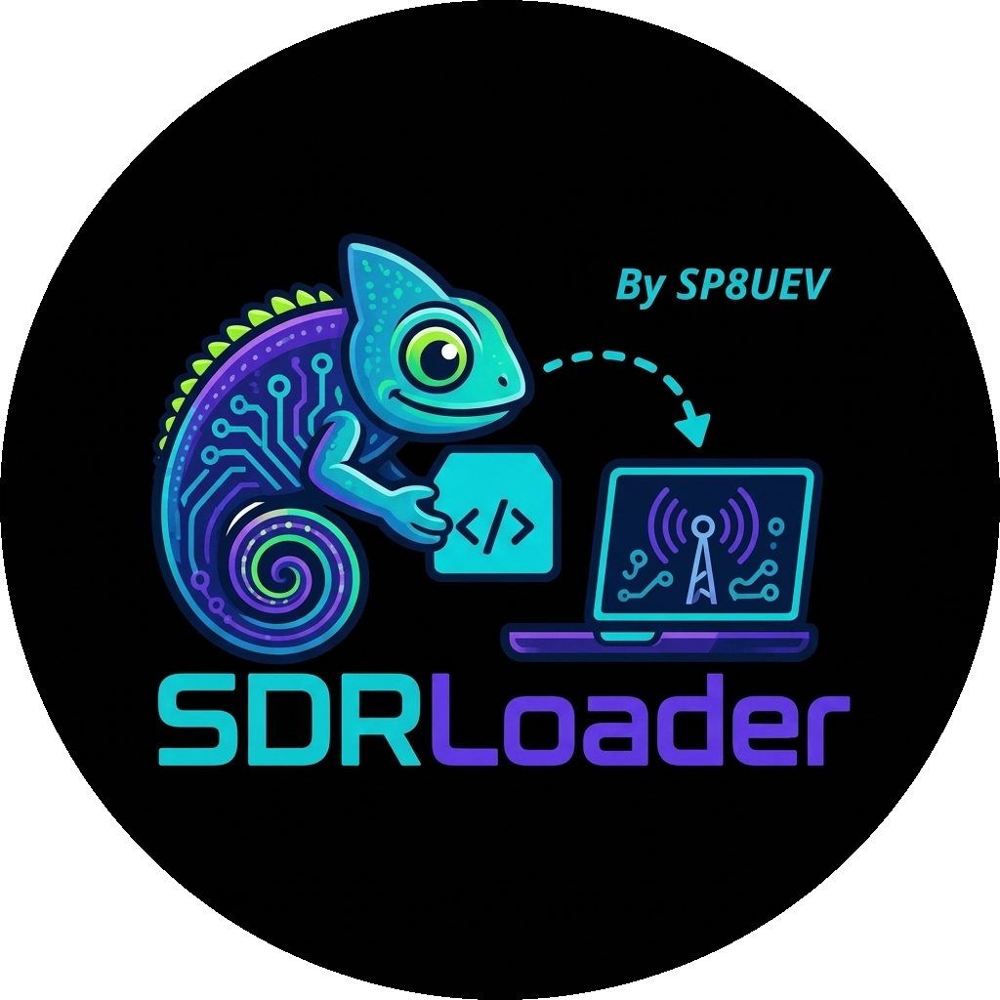

<p align="center">
  
</p>

<h1 align="center">SDRLoader</h1>

<p align="center">
  Finds the SDR radios plugged into your Windows PC and the SDR apps installed on it,
  then sets up the drivers they need.
</p>

<p align="center">
  <a href="../../actions/workflows/build.yml"></a>
  
  
  
</p>

---

**SDRLoader** is a small, open-source helper for Windows 10 and 11. It scans for the
SDR radios that are plugged in and the SDR programs on the computer, then proposes
exactly what to install: the USB driver each radio needs (WinUSB -- automatically,
or via Zadig), `rtlsdr.dll` where a program looks for it, and the manufacturers'
own driver installers. **You decide what happens, every fetched file is verified
before use, and every replaced file is backed up so the last run can be undone.**

It is a companion to closed-source SDR programs (such as ChameleonSDR) that cannot
ship GPL drivers themselves: SDRLoader fetches the drivers from their publishers, at
your request, the way you would by hand.

## What it does

1. **Radios.** Lists the SDR radios that are plugged in and the USB driver Windows
   gave each one (e.g. an RTL-SDR still on the DVB-T TV driver, an RSP with no driver).
2. **Programs.** Finds the SDR programs on the PC and which `rtlsdr.dll`, if any, each has.
3. **Plan.** Proposes the actions: install WinUSB, run a manufacturer's installer, put
   `rtlsdr.dll` in place, or install the Visual C++ runtime a driver needs.
4. **You tick, then press _Install ticked_.** Each file is checked first (size + SHA-256,
   or the publisher's digital signature). A replaced file is backed up, and
   _Undo last installation_ puts it back.

## What it never does

- Nothing changes until you press **Install ticked**; items that would replace an
  existing file start unticked.
- **Nothing about your computer is sent anywhere.** It goes online only to fetch a file
  you asked for, from that file's publisher.
- It never redistributes manufacturers' software -- their installers are downloaded
  from them and run in front of you, with their own licences.
- It never touches programs that ship their own drivers (SDR++, SDRangel, SatDump,
  CubicSDR, Gqrx, SDR Console) -- it only reports them.
- It never scans whole drives unless you ask, and only ever reads file **names**.

## Supported radios

| Radio | What SDRLoader sets up |
|---|---|
| **RTL-SDR** (RTL2832U, incl. Blog V3/V4) | WinUSB (automatic, or via Zadig) + `rtlsdr.dll` for the programs that load it |
| **HackRF One**, **Airspy R2 / Mini / HF+** | WinUSB -- usually already assigned by Windows (WCID) |
| **Nuand bladeRF** | Nuand's installer (driver, libbladeRF, FPGA images) |
| **ADALM-PLUTO** | Analog Devices' USB drivers |
| **SDRplay RSP** | opens the SDRplay API download page |
| **LimeSDR-USB**, **Ettus USRP B200 / B210** | WinUSB (automatic, or via Zadig) |
| **LimeSDR Mini / Mini 2** | opens FTDI's D3XX driver page (its FT601 bridge can't use WinUSB) |
| **FUNcube Dongle Pro / Pro+** | nothing -- Windows' own audio + HID drivers |

To actually *use* a LimeSDR or USRP you still install its host software (LimeSuite or
UHD); SDRLoader only sets up the USB driver.

## Programs it fills `rtlsdr.dll` for

| Program | `rtlsdr.dll` |
|---|---|
| ChameleonSDR | 64-bit, in `%APPDATA%\C-SDR\PUT_SDR_FILES_HERE` |
| SDR# (SDRSharp) | beside `SDRSharp*.exe`, in the build it uses (x86 / x64) |
| HDSDR | beside `HDSDR.exe`, when an RTL ExtIO plug-in is there |
| SDR++, SDRangel, SatDump, CubicSDR, Gqrx, SDR Console | ship their own -- left untouched |

## Download

Grab a ready-built `.exe` from the [**Releases**](../../releases) page. Every release
has two archives (each with `sdrloader.exe` and `sdrloader-cli.exe` inside):

- **`SDRLoader.zip`** -- the program; it fetches each driver from its publisher when needed.
- **`SDRLoader-winusb.zip`** -- built with automatic WinUSB install (libwdi), so the RTL-SDR
  driver step needs no Zadig window.

SDRLoader never bundles or redistributes drivers -- it only fetches them from their
publishers, at your request.

Builds are also attached to every CI run under the **Actions** tab (they expire; the
Releases above do not). `sdrloader.exe` is the window; `sdrloader-cli.exe --scan` prints
the same scan as text (handy for support requests).

## Automatic WinUSB install (and the certificate)

Giving an RTL-SDR, LimeSDR-USB or USRP the WinUSB driver is the step beginners stumble
on. SDRLoader can do it **without the Zadig window**, using **libwdi** (LGPL-2.1, the
library Zadig itself is built on): it builds a tiny WinUSB driver package for the one
radio, signs it with a certificate it generates, adds that certificate to the machine's
trusted stores so Windows accepts the driver, and binds WinUSB.

Because it adds a driver certificate and changes a device driver, it needs administrator
rights **and** a clear yes -- a prompt spells out each step first, and nothing runs
until you agree. It changes only that one radio's driver (undo in Device Manager; remove
the certificate in `certmgr.msc`). This path is compiled in only when the build includes
libwdi; otherwise SDRLoader proposes Zadig instead.

## Building

Needs CMake 3.16+ and MinGW-w64 GCC (MSYS2 UCRT64 or WinLibs). The binaries are linked
statically, so they run with nothing installed.

```bash
cmake -S . -B build -G Ninja -DCMAKE_BUILD_TYPE=Release
cmake --build build
./build/sdi-tests.exe
```

To compile the automatic WinUSB path in, build libwdi first (it has no CMake build of its
own -- `scripts/build-libwdi.sh` clones it, applies the patches in
`third_party/libwdi-patches/`, and produces `libwdi.a`):

```bash
scripts/build-libwdi.sh --clone external/libwdi v1.5.1
cmake -S . -B build-wdi -G Ninja -DCMAKE_BUILD_TYPE=Release \
      -DSDI_WITH_LIBWDI=ON \
      -DLIBWDI_INCLUDE_DIR=external/libwdi/libwdi \
      -DLIBWDI_LIBRARY=external/libwdi/libwdi/libwdi.a
cmake --build build-wdi
```

A radio or a program is added in one place: [`src/catalog.cpp`](src/catalog.cpp).

## Licence &amp; third-party

The code in this repository is **MIT** ([`LICENSE`](LICENSE)) and contains no third-party
code. The drivers and installers it fetches are other people's software under their own
licences, each from its publisher's own address -- see
[`THIRD-PARTY.md`](THIRD-PARTY.md). The optional libwdi build is LGPL-2.1; the program
stays relinkable and the modifications are shipped (`third_party/libwdi-patches/`).

## Trademarks

RTL-SDR, HackRF, Airspy, SDRplay, RSP, bladeRF, ADALM-PLUTO, LimeSDR, USRP, FUNcube, SDR#,
HDSDR, SDR++, SDR Console, CubicSDR, SDRangel, SatDump, Gqrx, SDRuno, SDRconnect, Zadig,
FTDI and the other names are their owners' trademarks, used only to say what SDRLoader
works with. This project is not affiliated with, or endorsed by, any of them.
